# Demo screens: church onboarding by text

Static iPhone chat mockups of the flow in [the build brief](../build-brief.md). Every church and person shown is made-up test data from the hackathon's Track 1 `churches.csv`. Gray tags under messages show what the system records behind the scenes.

- All screens on one page: [`index.html`](index.html)
- One screen per file: [`screens/`](screens/)
- Brand assets: Baptize The World globe and wordmark from the [hackathon repo](https://github.com/FaithTechGlobalLabs/faithtech-socal-hackathon/tree/main/assets/brand), approved for hackathon use.

## Full onboarding flow (English)

Pastor Pablo Dela Cruz, Grace Fellowship Tacloban, Philippines.

| E1 · First text, language, opt-in | E2 · Register the church | E3 · Confirm details | E4 · Approved, welcome pack, team invite |
|---|---|---|---|
| 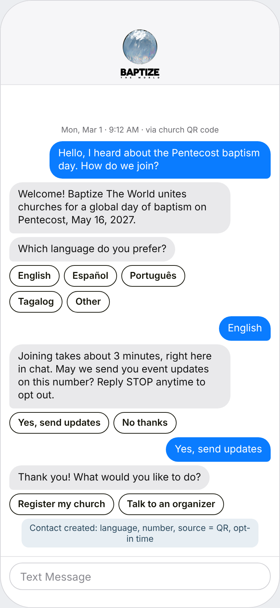 | 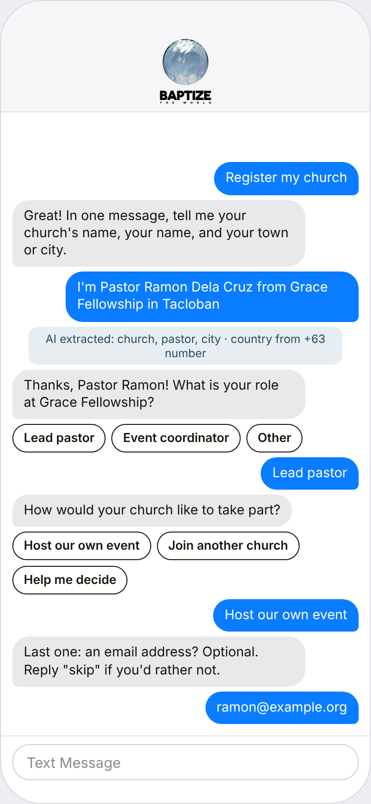 | 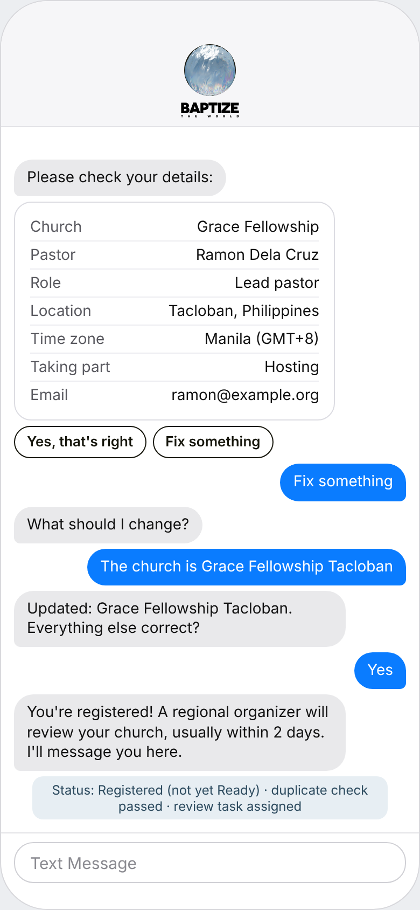 | 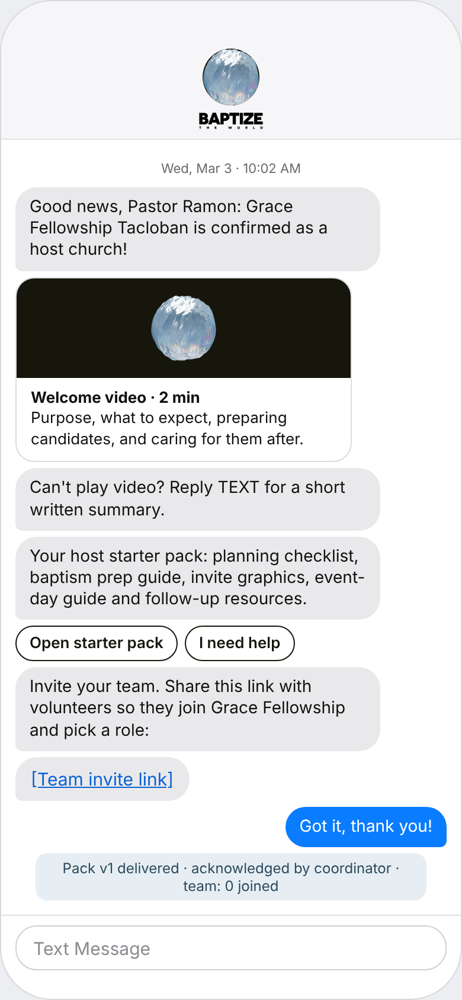 |

| E5 · Readiness checklist | E6 · Report baptisms | E7 · Follow-up and opt-out |
|---|---|---|
| 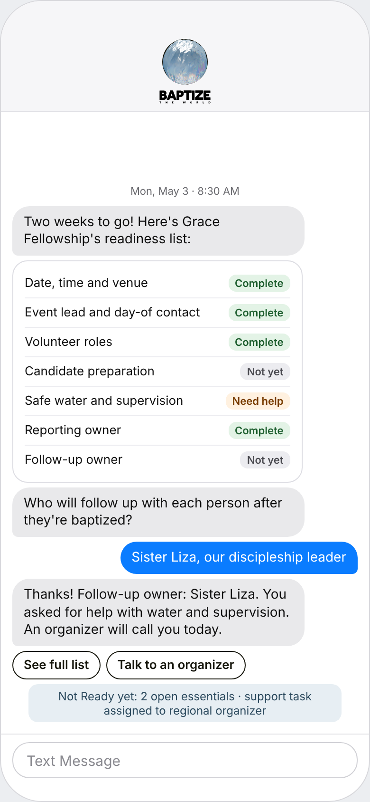 | 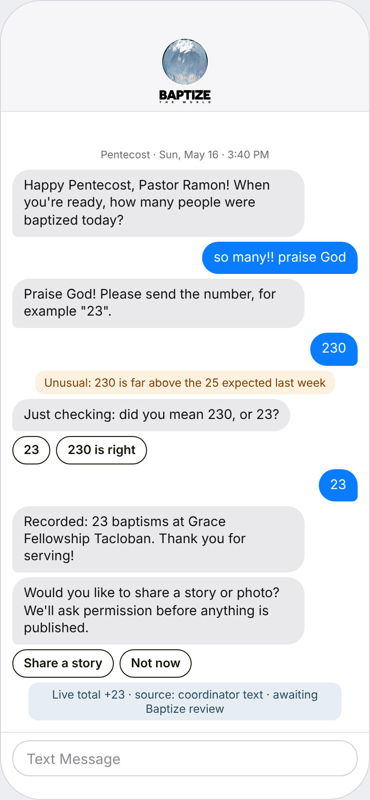 | 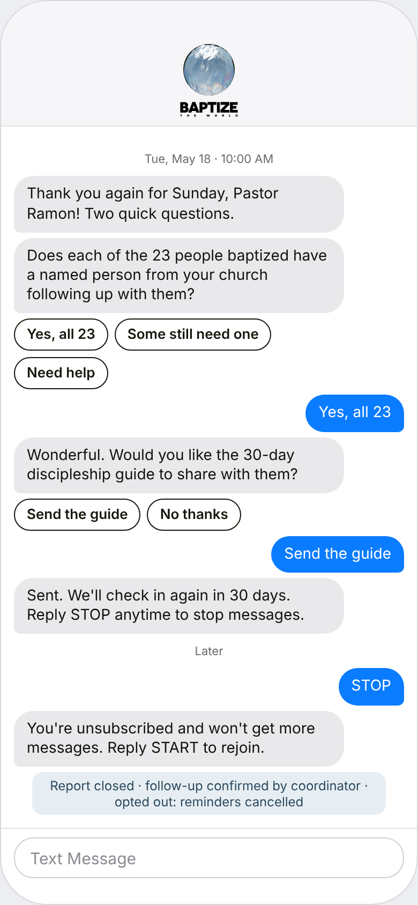 |

## Quick demo (Spanish)

Pastor Rubén Quispe, Iglesia Luz del Valle, Cusco, Peru.

| 1 · Welcome and consent | 2 · Register in one message | 3 · Confirm and go live | 4 · Report baptisms |
|---|---|---|---|
| 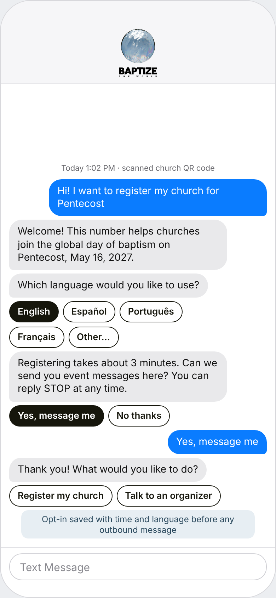 | 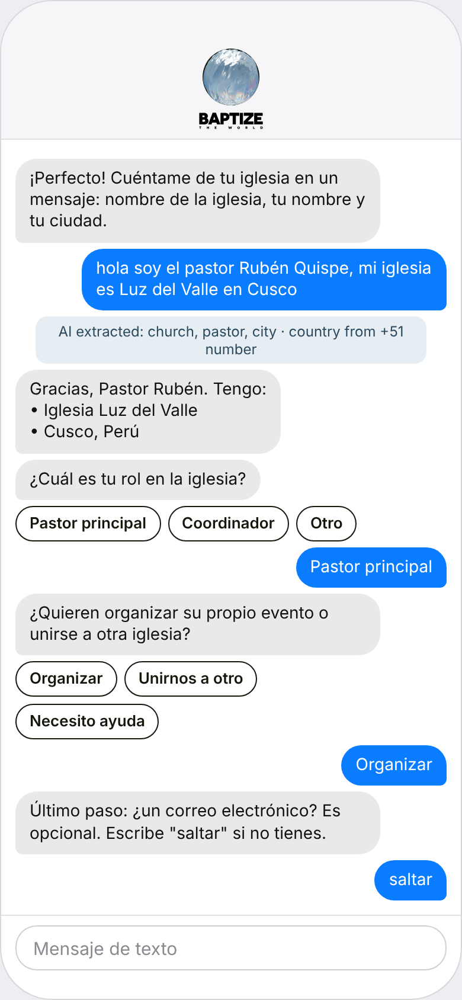 | 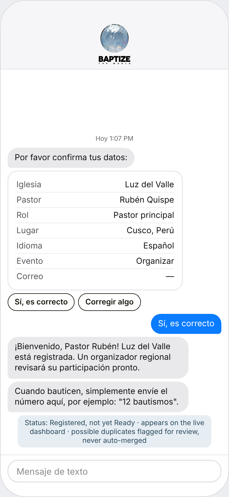 | 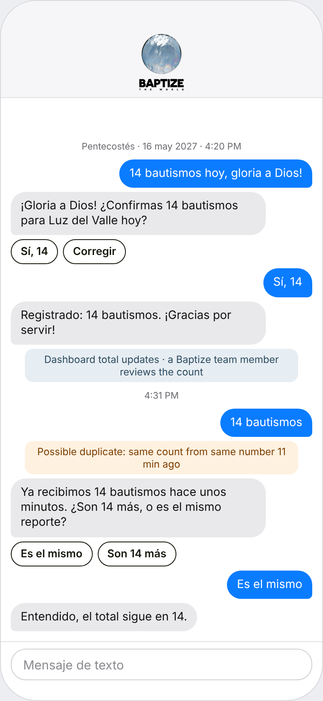 |
